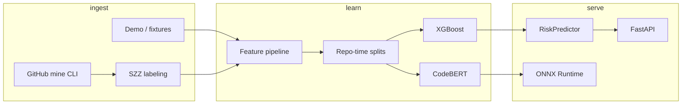

# Architecture

## Data flow

1. **Ingest** synthetic demo rows or optional mined PR metadata.
2. **Label** via provided labels or SZZ heuristics (never claimed as ground truth).
3. **Features** from diffs + metadata; preprocess fit on train only.
4. **Train** XGBoost baseline and optional CodeBERT demo fine-tune.
5. **Serve** via FastAPI with one loaded bundle; optional ONNX export for transformers.

## Packages

| Package | Role |
|---------|------|
| `coderisk.data` | Demo, GitHub client, SZZ, splits |
| `coderisk.features` | Diff/metadata/sklearn pipeline |
| `coderisk.models` | XGBoost, CodeBERT, calibration |
| `coderisk.evaluation` | Metrics, ranking, plots, latency |
| `coderisk.inference` | Predictor, validation, ONNX |
| `coderisk.api` | FastAPI routes and lifespan |
